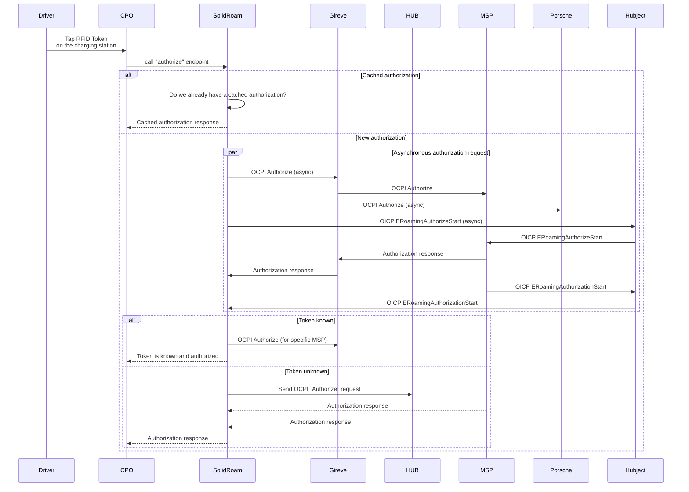

# Token Authorization

1. Driver arrives at the charger and taps her RFID token on the charge point 
2. The CPO calls the `authorize` endpoint with the token_id
3. SolidRoam checks if the token is already authorized (in OCPI, successful authorizations are cached for 15 minutes)
4. SolidRoam checks if the token is known to us (the CPO)
5. If the token is not authorized at the moment, SolidRoam sends an OCPI `Authorize` request to the known MSP or in case of an unknown token, all connected MSPs and HUBs asynchronously (`authorize_with_msps()`)
6. The MSP checks the driver's credit and makes a credit reservation
6. The MSP responds to the HUB, the HUB responds to us
7. **We consider the fastest positive response only**

In the future, we want to wait a moment after the first positive response to see if we get a response from a cheaper HUB or a cheaper direct connection.
For example, Hubject set prices per charger and Gireve per transaction.

