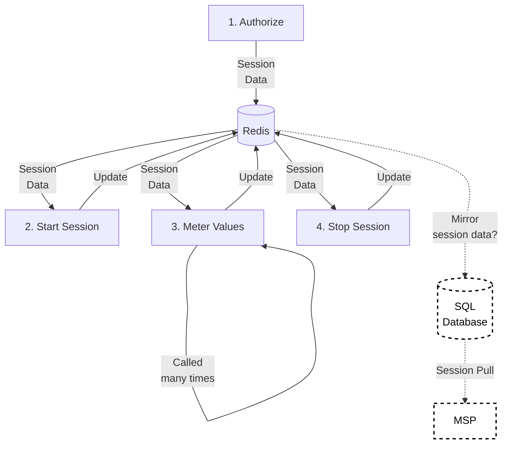
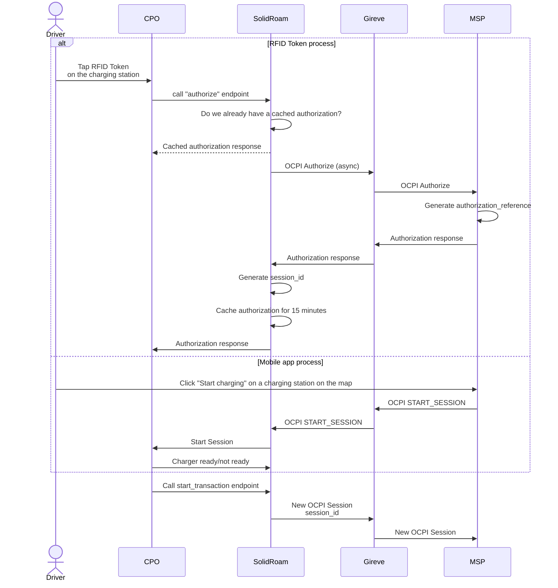
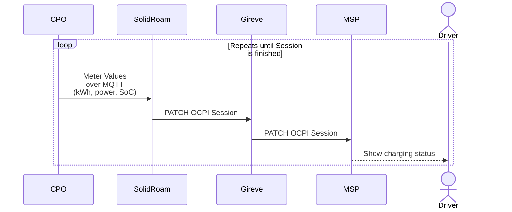
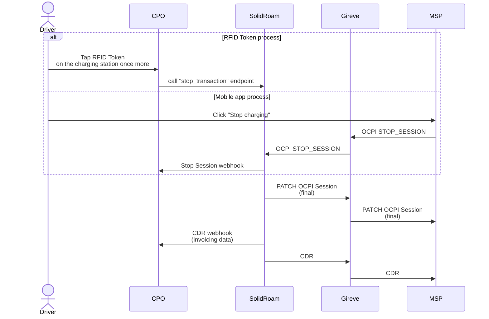

# Charging

## Definitions

- CPO: Charge Point Operator
- MSP: Mobility Service Provider
- HUB: A central system that connects CPOs and MSPs
- OCPI: Open Charge Point Interface (industry standard)
- OICP: Open InterCharge Protocol (Hubject proprietary)
- Other proprietary roaming protocols exist

## The Charging Process

These endpoints are a part of the `CPO API`, which is called by a CPO which is our customer and who we provide 
roaming capabilities to. Authorize, Start Session and Meter Values are the endpoints, 
which rely on data stored in Redis.
Meter values is called hundreds of times during a charging session, the others only once per session.

## The Sequence

1. When the CPO asks for Token Authorization through our simple CPO API, we send an authorization request to the HUB. 
Depending on which hub the MSP is connected to, we send the message over OCPI or OICP.
2. The HUB asks MSP for authorization.
3. MSP responds to HUB, HUB responds to us and we respond to the CPO.
4. If the RFID Token is authorized, we create an OCPI Session with status PENDING. 
4. The CPO calls the start_session endpoint, and we send the new OCPI Session to the HUB.

## Starting a charging session

Here we have the Gireve hub as an example, but it could be e-Clearing.net, Mobi-e or our own hub product.

## Meter values during a charging session

After the Session has been established, the CPO sends us meter values. The meter values contain:
- kWh charged so far 
- The power at this moment
- In the case of DC charging also the State of Charge (SoC)

## Stopping an ongoing charging session

