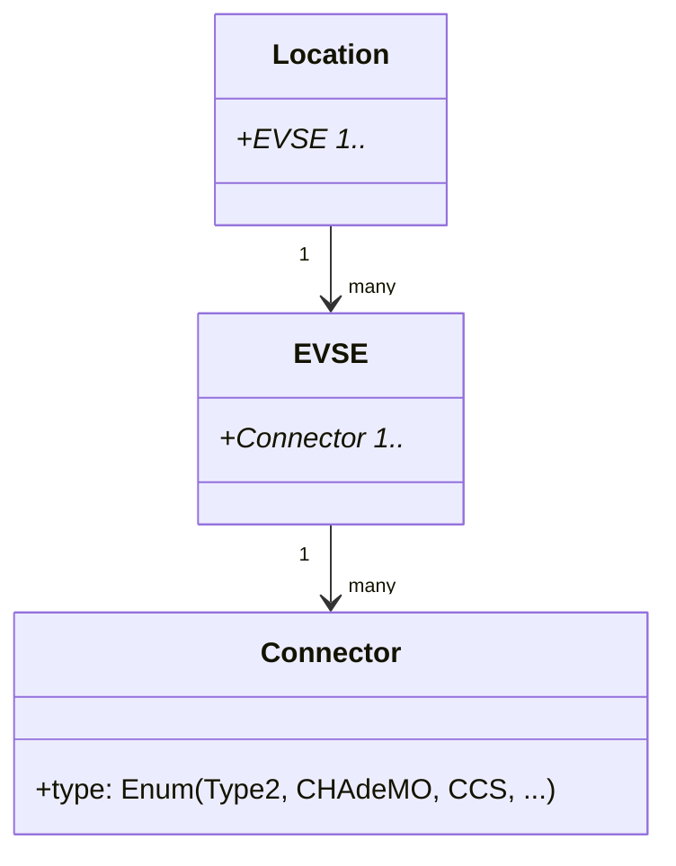
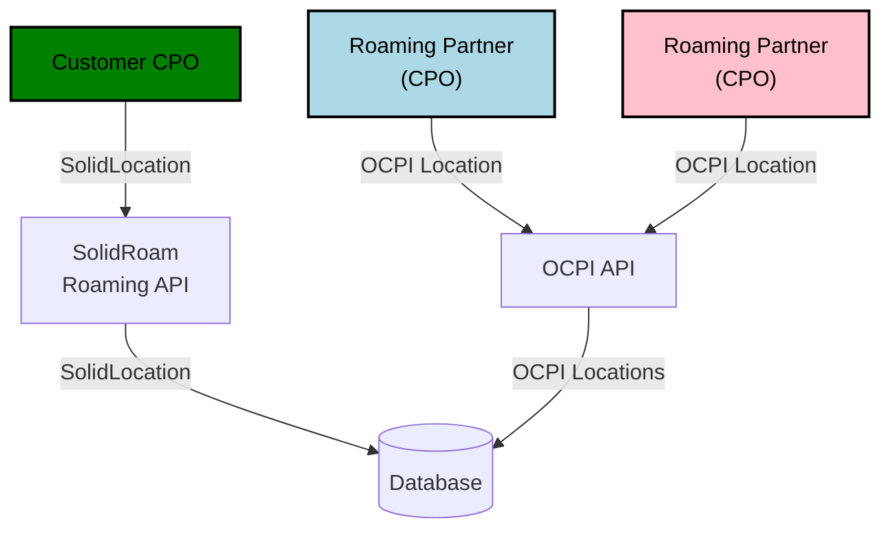
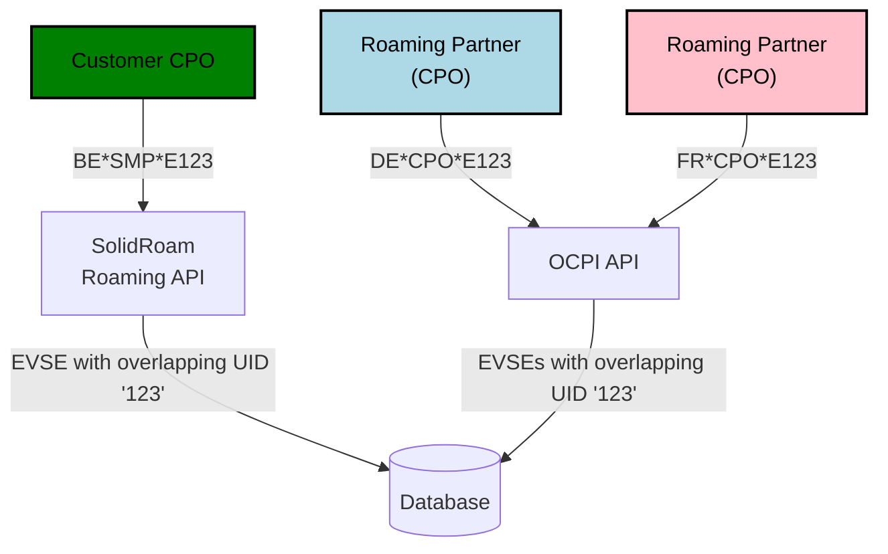

# Locations, EVSEs and Connectors

## EVSE = Electric Vehicle Supply Equipment

An EVSE is a device which and charge one car at a time. One physical cabinet ("charge point") can house one or more EVSEs.
An EVSE can have one or more Connectors.

## Connector

In OCPI terminology, a Connector is a physical cable or connector that can be used in connecting an electric vehicle to an EVSE. 
A connector can be Type 2 for AC power, CHAdeMO or CCS for DC power, etc.

## Location

A Location is a physical place, such as parking lot or garage, where one or more EVSEs are installed.
A location can have one or more EVSEs.

## EVSE ID

An EVSE ID is a unique identifier for an EVSE. It is composed of a country code, a party ID and a unique identifier.
The format is specified in the [eMI3 standard](https://www.emi3group.com/).



## EVSE master data

`SolidLocation` is our proprietary format, which is based on `OCPI Location` and complemented 
with some `Hubject OICP` fields.

Here you can see the propagation of Locations to our primary database:



It is important to consider that when we act in both the CPO and the MSP role, we will
need to store Locations from our customer CPO and our roaming partner CPOs. When we look inside the Location objects, we could see this kind of example EVSEs: 



In the above example, we can only modify the customer CPO's EVSEs, because any other EVSE is owned by someone else.
When using Django ORM, we need to get and filter based on Evse.evse_id, not only with Evse.uid, which will sometimes overlap between operators, which results in multiple hits.

For example:

```python
evse = Evse.objects.get(evse_id="BE*SMP*E123")
```
