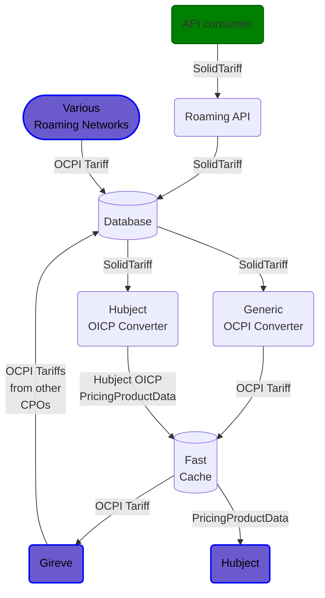
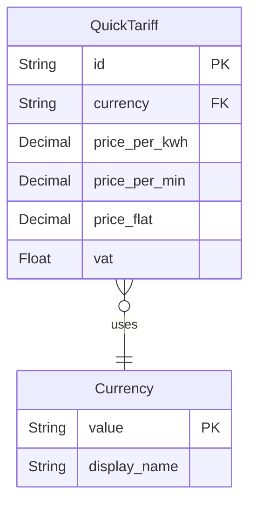
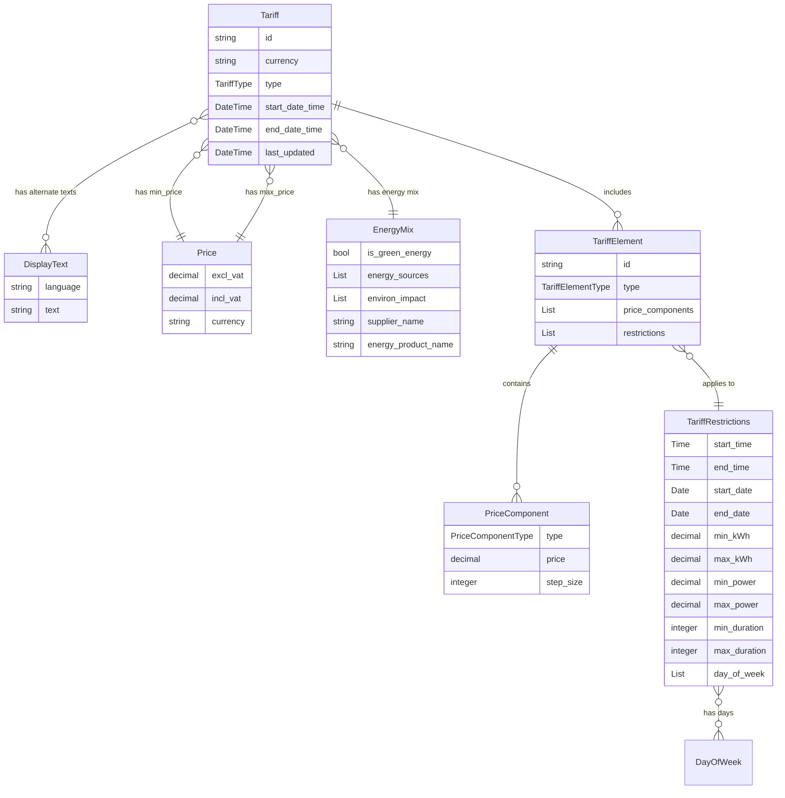
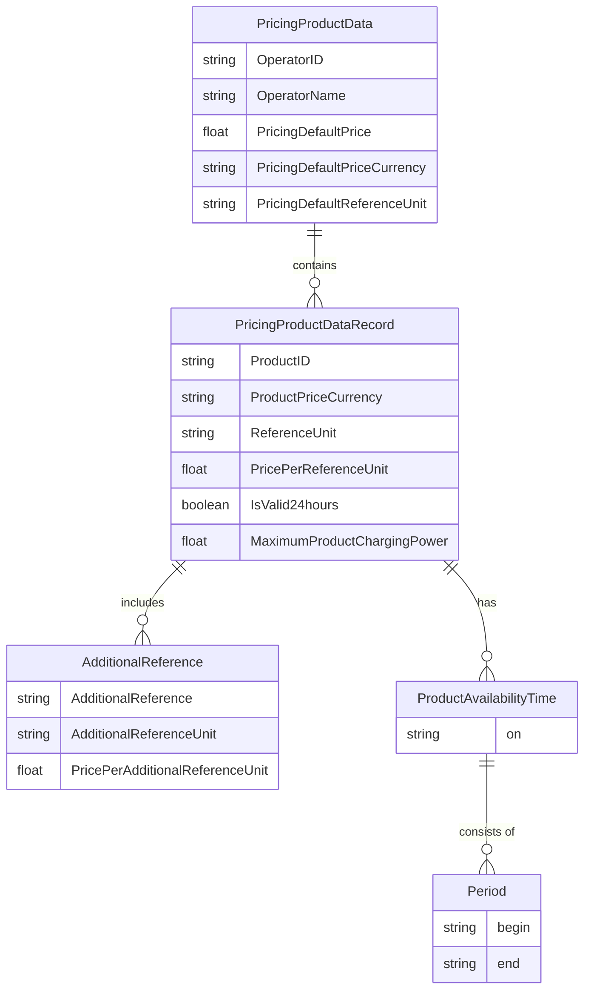

# Tariffs and pricing

## CPO API

The QuickTariff object and endpoint allows the CPO to provide us with pricing information, 
which we reformat and restructure for the roaming networks. 
We receive the data through our Roaming API, which is the main entry point for all data from our customer.

## Goal Architecture

To reach this, we need conversion from QuickTariff to both OCPI and OICP. OCPI conversion already exists. 
See [ST-33](https://solidroam.agilemaximum.com/item/33/refine/) for Hubject OICP conversion.

Redis may be expensive to be used as a fast cache here, but we may not have a choice.

You can see below that OCPI and OICP have different ways of structuring tariffs.
To be able to cater to future needs, we need to store the data in its original form, as we receive it from the CPO.

### CPO API QuickTariff structure

The QuickTariff endpoint is the most simple way to provide pricing information. There is
no time component, but only the three pricing dimensions that can be combined freely.
From this simple structure we form the OCPI and OICP pricing structures.

## OCPI Tariffs

Unlike the simpler QuickTariff structure, the OCPI 2.2.1 Tariff structure allows for more complex pricing schemes. 
While this flexibility enables intricate pricing models, it may not always benefit
consumers who often wish for clarity.

A simple OCPI Tariff might consist of just one PriceComponent valid 24/7, meaning it is not connected to a TariffRestrictions.
PriceComponent types—FLAT, ENERGY, TIME, and PARKING_TIME—can be scoped using any combination of
TariffRestrictions. These scopes include day-of-week, date, time, energy, power, and duration restrictions.

For more complex tariffs, multiple PriceComponents can be defined, each with its own TariffRestrictions. This allows for
different pricing at various times of the day or days of the week. We can even implement dynamic pricing schemes where
prices fluctuate based on energy market rates.

### OCPI Tariff structure

## Hubject OICP 2.3 Pricing

