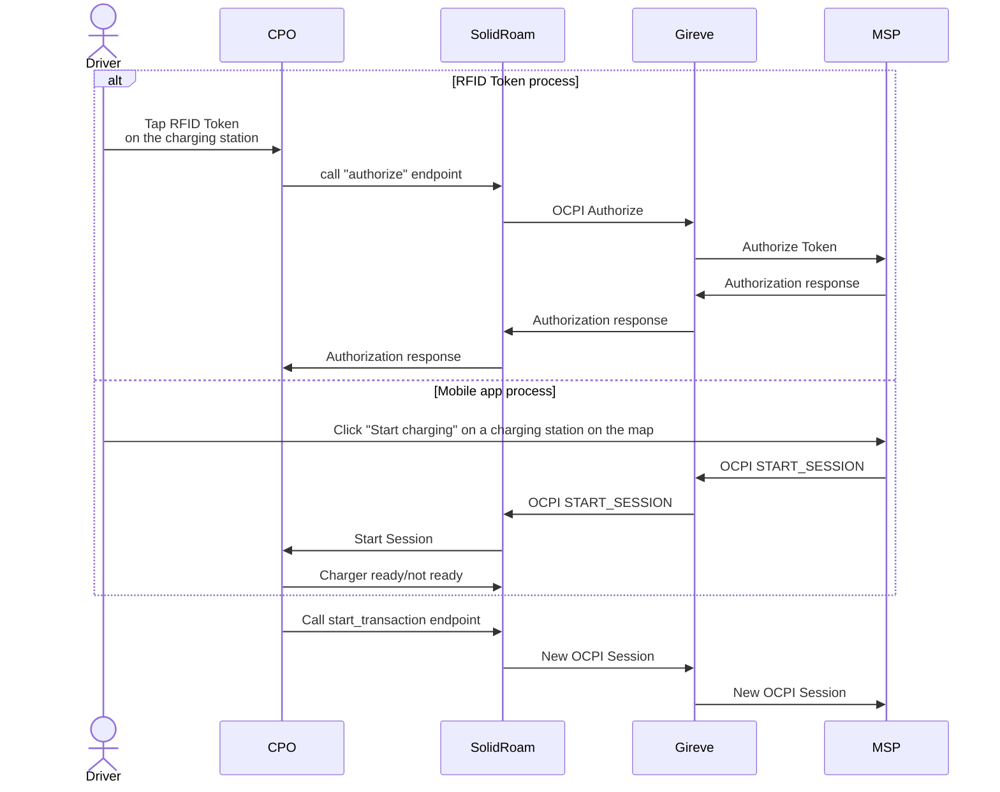
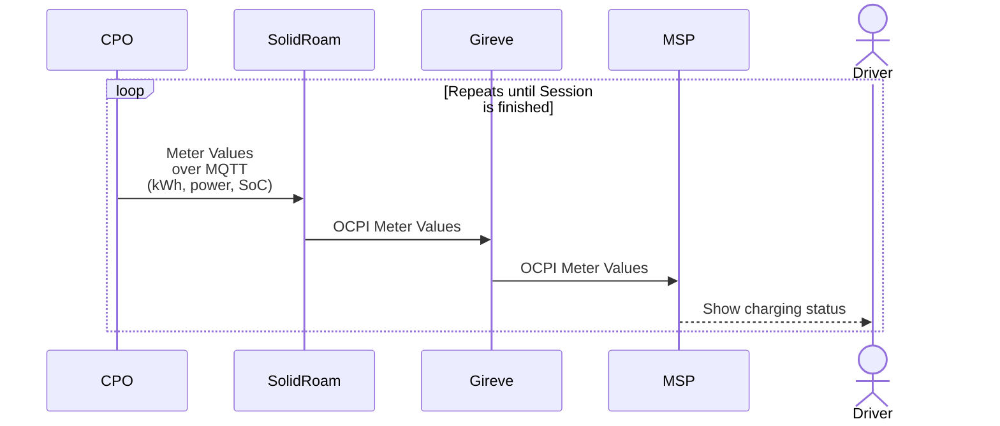
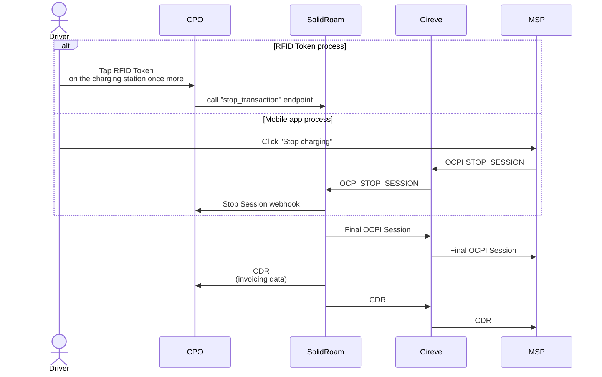

# FastAPI/NinjaAPI routers

## Introduction

When we were providing compatibility testing tools, Django Rest was the way to go.
The DRF endpoints provide a browsable HTML interface with diagrams and explanations about the process.
The FastAPI routers must not be mixed with the Django Rest routers, as the endpoints work together in sequence 
and their data needs differ.

## Definitions

- CPO: Charge Point Operator
- MSP: Mobility Service Provider
- HUB: A central system that connects CPOs and MSPs
- OCPI: Open Charge Point Interface (industry standard)
- OICP: Open InterCharge Protocol (Hubject proprietary)
- Other proprietary roaming protocols exist

## Charging process

1. When the CPO asks for Token Authorization through our simple CPO API, we send an authorization request to the HUB. 
Depending on which hub the MSP is connected to, we send the message over OCPI or OICP.
2. The HUB asks MSP for authorization.
3. MSP responds to HUB, HUB responds to us and we respond to the CPO.
4. If the RFID Token is authorized, we create an OCPI Session with status PENDING. 
4. The CPO calls the start_session endpoint, and we send the new OCPI Session to the HUB.

Let's use Gireve hub as an example, but it could be e-Clearing.net, Mobi-e or our own hub product.

## Meter values during a charging session

After the Session has been established, the CPO sends us meter values. The meter values contain:
- kWh charged so far 
- The power at this moment
- In the case of DC charging also the State of Charge (SoC)

## Stopping an ongoing charging session

