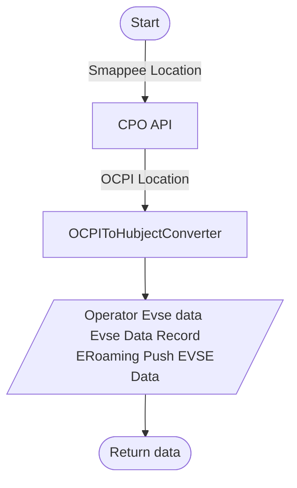
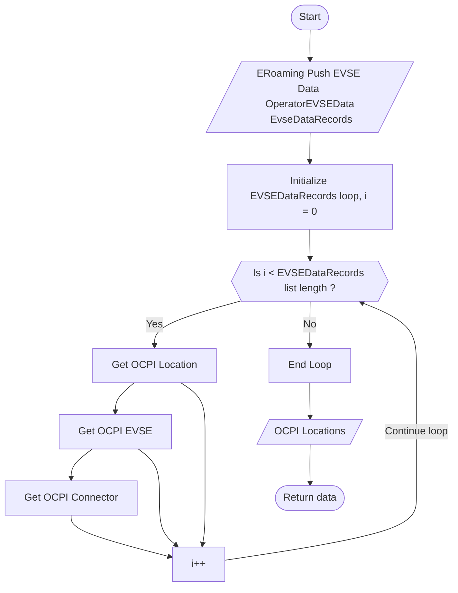

### Converters

There are two types of converters in the `integrations` directory: 
1. `ocpi to hubject converter`
2. `hubject to ocpi converter`. 

Both of the converters convert only the data related to Location object.

Following graph depict the OCPI to Hubject Location object converter.

- OCPI to hubject converter includes separate functions to get OperatorEVSEData and
EVSEDataRecords. However, `convert_to_operator_evse_data` depends on the 
`_convert_to_evse_data_record`.

- The `ERomaingPushEvseData` object has to be created when needed. It is not a part of the converter due to
`ActionType`. ActionType can only be determined while using. Therefore, it has been removed from the converter to 
remove any side effects from the functions

Following graph depict the Hubject to OCPI Location object converter.

#### Notes

1. `hubject to ocpi converter` is uncompleted due to the `ocpi_master_id` field in the Locations. 
Hubject does not have a ocpi master.
