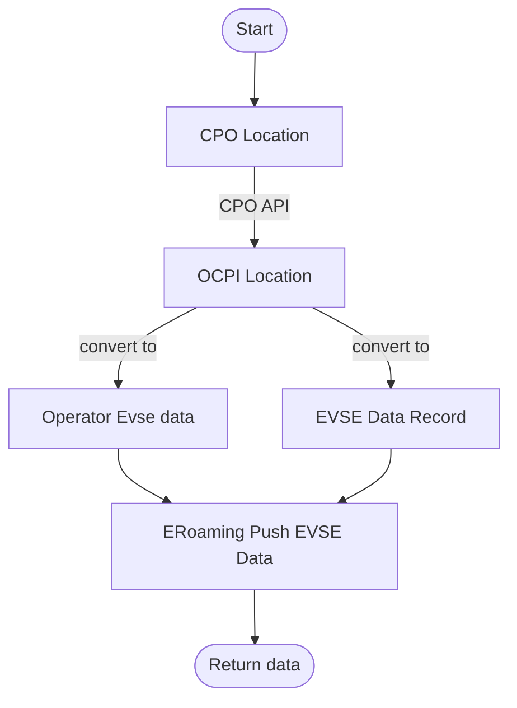
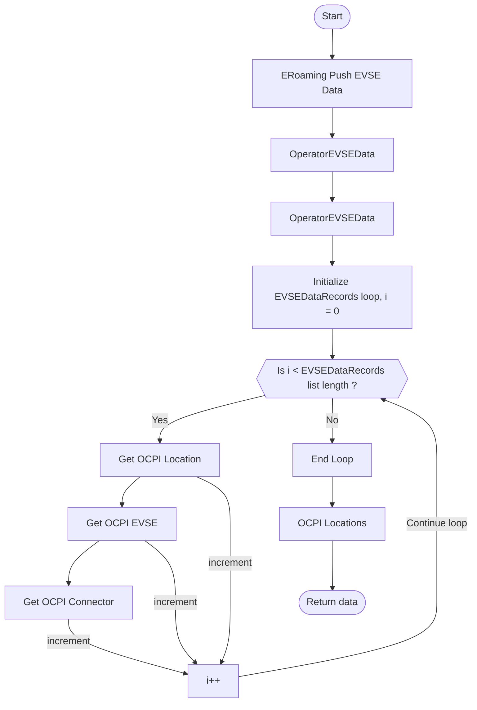

### Converters

There are two types of converters in the `integrations` directory: 
1. `ocpi to hubject converter`
2. `hubject to ocpi converter`. 

Both of the converters convert only the data related to Location object.

Following graph depict the OCPI to Hubject Location object converter.

Following graph depict the Hubject to OCPI Location object converter.

#### Notes

1. `hubject to ocpi converter` is uncompleted due to the `ocpi_master_id` field in the Locations. 
Hubject does not have a ocpi master.
