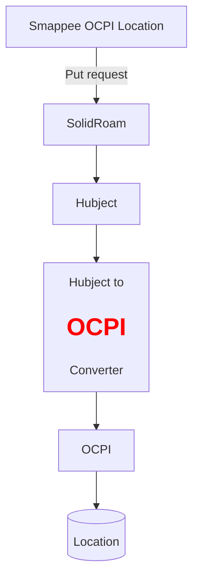

### Converters

There are two types of converters in the `integrations` directory: `ocpi to hubject converter`
and `hubject to ocpi converter`. At the moment only the objects related to Location and ERoamingPushEVSEData 
are converted.

This is useful when we get information about Location from either formats.

