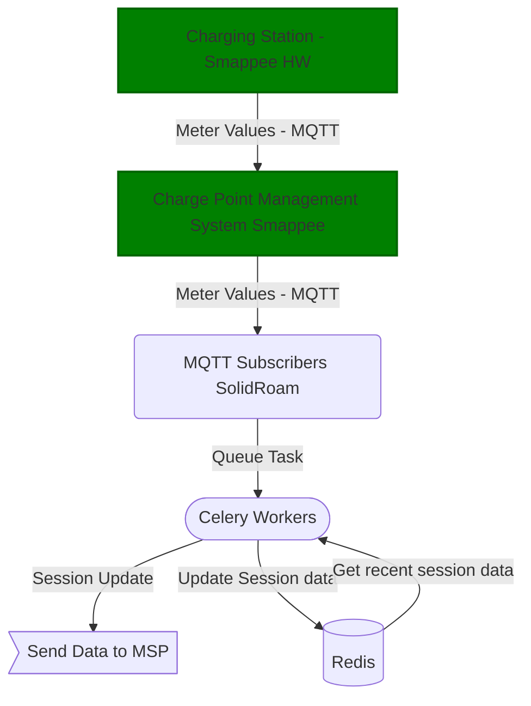

# MQTT Meter Values receiver

We receive meter values which originate from a charging station using a shared subscription.
The shared subscription works as a load balancing mechanism, where multiple
subscribers can receive messages from the same topic while making sure that
only one subscriber will process the message.

## Usage

- Start the `emqx` MQTT broker using `docker-compose`
- Start the subscriber `mqtt.py` on the command line or using pycharm
- Start the publisher `mqtt_publisher.py` on the command line or using pycharm

You should see output similar to this when running two subscribers in parallel:

```
Connected successfully to the broker.
Subscribed to topic: $share/session_group/session/+/metervalues
kwh: 11
kwh: 13
kwh: 15
kwh: 17
```

## Architecture

All the MQTT messages are routed by an MQTT Broker (emqx product run by Smappee). The connections
remain open and the broker will route the messages from the publishers to the correct subscribers.
The shared subscription mechanism ensures that only one subscriber will process the message.


