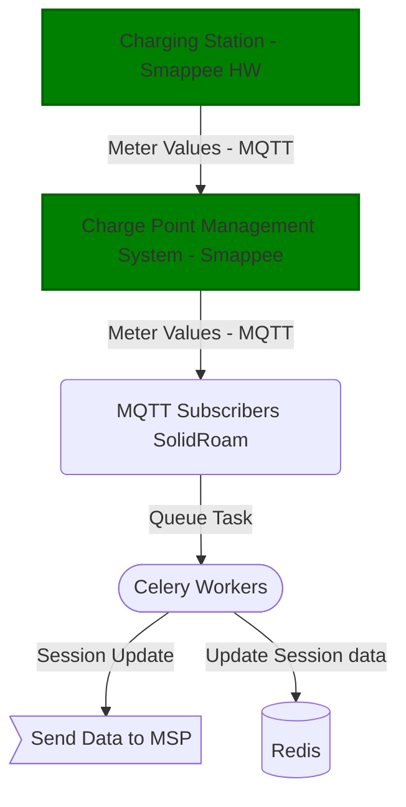
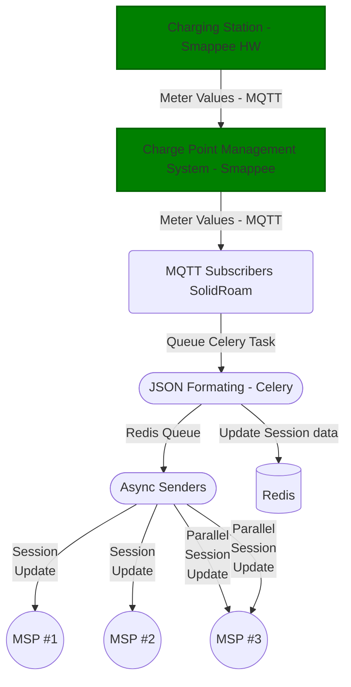

# MQTT Meter Values receiver

We receive meter values which originate from a charging station using a shared subscription.
The shared subscription works as a load balancing mechanism, where multiple
subscribers can receive messages from the same topic while making sure that
only one subscriber will process the message.

## Usage

- Start the `emqx` MQTT broker using `docker-compose`
- Start the subscriber `mqtt.py` on the command line or using pycharm
- Start the publisher `mqtt_publisher.py` on the command line or using pycharm

You should see output similar to this when running two subscribers in parallel:

```
Connected successfully to the broker.
Subscribed to topic: $share/session_group/session/+/metervalues
kwh: 11
kwh: 13
kwh: 15
kwh: 17
```

## Architecture

All the MQTT messages are routed by an MQTT Broker (emqx product run by Smappee). The connections
remain open and the broker will route the messages from the publishers to the correct subscribers.
The shared subscription mechanism ensures that only one subscriber will process the message.

**Todo**: We need to consider MSPs that process incoming messsages slower than the other ones.
We should not build up a queue of messages to make everyone wait for the slowest MSP.

Thoughts from GPT o1:

### Conclusion:

By configuring Celery to use separate queues and dedicated workers for each MSP, you ensure that tasks are processed independently. This prevents slow responses from one MSP from affecting the overall system performance and allows faster MSPs to operate efficiently without unnecessary delays.

### Additional Tips:

- Monitoring: Use Celery’s monitoring tools (like Flower) to keep an eye on task queues and worker performance.
- Timeouts and Retries: Implement timeouts and retry mechanisms for tasks communicating with slow MSPs to handle potential failures gracefully.
- Load Balancing: If possible, distribute tasks evenly and consider scaling your worker processes based on the load and response times of each MSP.

### Problem with maintaining a thousand queues

The problem with maintaining a thousand queues is that it can lead to increased complexity and resource consumption. Each queue requires resources to manage and process tasks, and having a large number of queues can strain the system and make it harder to maintain and scale.

### Solution:

One solution is to use a single queue with multiple workers and implement a load balancing mechanism to distribute tasks evenly among the workers. This approach can help reduce complexity and resource consumption while ensuring that tasks are processed efficiently.
We could limit the number of concurrent tasks per MSP to prevent one MSP from monopolizing the resources and slowing down the system.
Also, we could analyse the performance of each MSP and adjust the number of workers and resources allocated to each queue accordingly.
This may be too complex to implement and maintain, but it could be a more scalable and efficient solution in the long run when we have thousands of MSPs.

Please take a look at possible_concurrency_solution.py.

### Solution #1: Celery



### Solution #2: One queue, async processing in one or more processes

The async senders will limit concurrency per MSP and prevent one MSP from monopolizing the resources and slowing down the system.
Optimally the concurrency limit is determined dynamically based on the request/response timestamps.
If they overlap, there is parallel processing.


