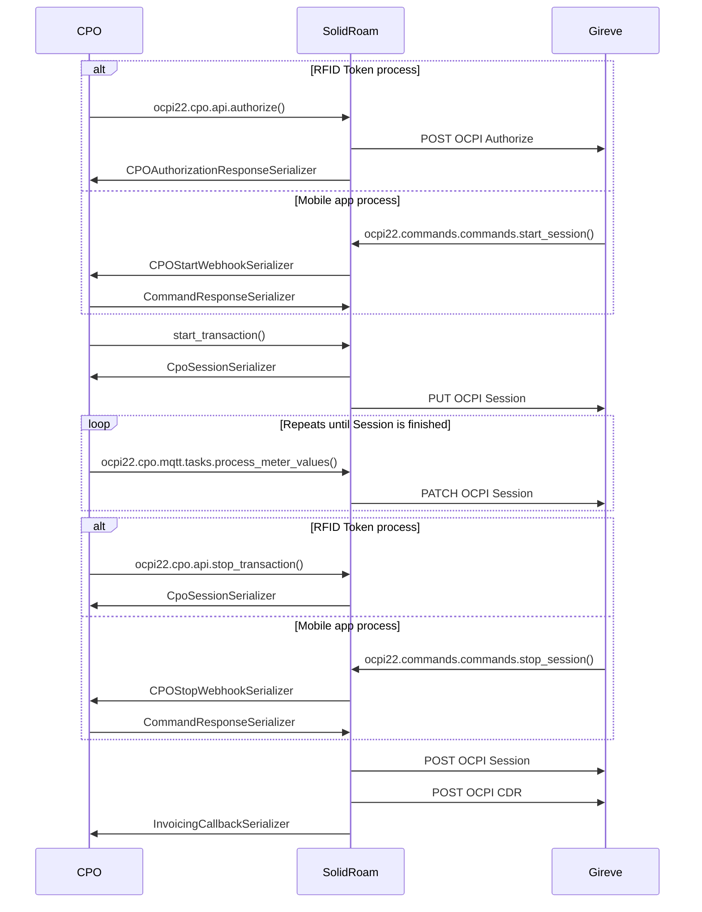

# CPO API

This directory and specifically the `api.py` file contains the implementation of the CPO API.
The API provides our CPO customer a shortcut to roaming networks. The simplified API is based on the OCPI protocol,
but suits Hubject OICP as well.

These are the elements involved in the optimised RFID and mobile app charging processes:

